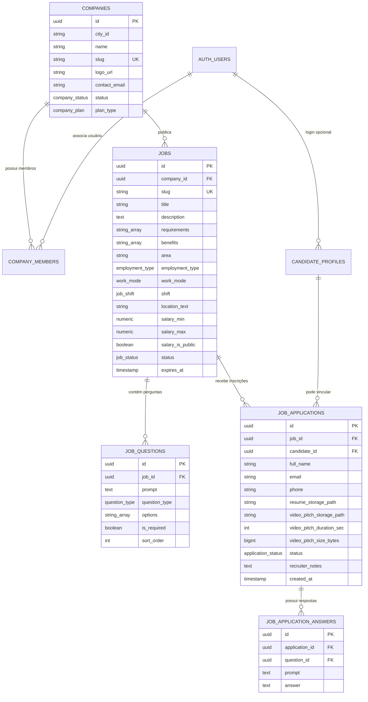

# Planejamento do Banco de Dados — Módulo Trabalhe Conosco
**Portal TV Viamão · v1.0**  
**Data:** 18 de outubro de 2026  
**Status:** Especificação Técnica e Planejamento de Persistência (Supabase PostgreSQL)  

---

## 1. Visão Geral da Modelagem

O modelo de dados foi concebido para o **Supabase PostgreSQL**, priorizando:
1. **Isolamento Multi-Tenant Estrito**: Cada empresa anunciante ou assinante acessa exclusivamente suas próprias vagas e os candidatos que se inscreveram nelas.
2. **Prevenção de Duplicidade de Candidaturas**: Uma constraint única `UNIQUE(job_id, email)` impede candidaturas repetidas do mesmo candidato para a mesma oportunidade.
3. **Segurança de Acesso e LGPD**: Políticas de *Row Level Security* (RLS) habilitadas em 100% das tabelas.
4. **Proteção de Mídia Sensível**: Buckets de armazenamento privados no Supabase Storage para currículos (PDF/DOC) e vídeos de apresentação (WebM/MP4 até 100 MB), acessíveis apenas via links assinados de curta duração gerados no servidor.

---

## 2. Diagrama Entidade-Relacionamento (ERD)

---

## 3. Dicionário de Dados e Estados

### 3.1 Tipos Enumerados (ENUMs)
- `job_status`: `'published'` (ativa/aberta), `'paused'` (pausada temporariamente), `'filled'` (preenchida — bloqueia novas candidaturas), `'archived'` (arquivada), `'pending_review'` (aguardando moderação).
- `employment_type`: `'CLT'`, `'PJ'`, `'MEI'`, `'Estágio'`, `'Temporário'`.
- `work_mode`: `'Presencial'`, `'Híbrido'`, `'Remoto'`.
- `job_shift`: `'Manhã'`, `'Tarde'`, `'Noite'`, `'Integral'`, `'Escala'`.
- `application_status`: `'submitted'` (enviada), `'under_review'` (em análise), `'interview'` (entrevista), `'approved'` (aprovada), `'rejected'` (não selecionada).
- `company_status`: `'pending'`, `'active'`, `'suspended'`.
- `company_plan`: `'assinante'`, `'anunciante'`, `'gratuito'`.
- `question_type`: `'text'`, `'choice'`, `'boolean'`.

---

## 4. Estratégia de Storage (Privacidade e Arquivos)

| Recurso | Bucket Supabase | Visibilidade | Limite de Tamanho | Formatos Permitidos | Política de Acesso |
| :--- | :--- | :--- | :--- | :--- | :--- |
| **Currículos** | `resumes` | Privado | 5 MB | `.pdf`, `.doc`, `.docx` | Apenas recrutadores da empresa contratante e o candidato titular. |
| **Vídeo Pitch** | `presentation-videos` | Privado | 100 MB | `.mp4`, `.webm`, `.mov` | URLs assinadas (`createSignedUrl`) com expiração de 60 minutos para a empresa. |
| **Logos das Empresas** | `company-assets` | Público | 2 MB | `.webp`, `.png`, `.jpg`, `.svg` | Leitura pública para exibição nos cards e cabeçalhos. |

---

## 5. Regras de Transição (Frontend-First com Mocks)

Conforme instrução do usuário:
1. **Fase Atual**: Todo o frontend, as páginas e as interações do usuário rodam via **repositório reativo com dados mockados em memória** (`JobsMockStore`), sem conexões de rede externas nem banco ativo.
2. **Fase Futura de Ativação do Banco**: Para ativar o Supabase PostgreSQL em produção, bastará aplicar o arquivo `supabase/migrations/20261018000000_trabalhe_conosco.sql` e alternar o adapter no `src/lib/data/index.ts`.
